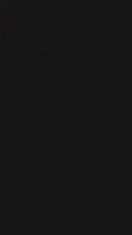
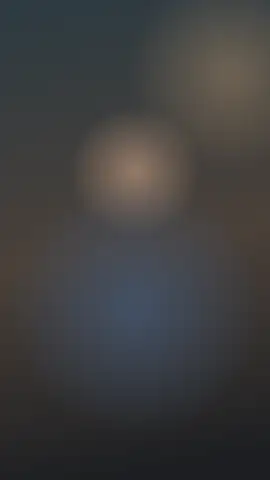

# Tamo Criando Motion

Banco de animações da marca **Novo MKT** e um painel pro Premiere Pro que coloca a animação, com o teu texto, direto na timeline.

São 17 animações pensadas como **sinalização** do roteiro (gancho, quem fala, onde estamos, argumento, prova, fechamento), com a identidade que já existe nos teus posts: Anton, Montserrat e Space Mono, papel creme, carvão, ameixa, brasa e âmbar, o raio e a chama.


- **Ver tudo rodando e editar texto:** abre `gallery/index.html` no navegador.
- **Instalar no Premiere:** [docs/INSTALAR.md](docs/INSTALAR.md).
- **Qual animação usar em cada momento do vídeo:** [docs/GUIA.md](docs/GUIA.md).

---

## As animações

| | Animação | Pra quê |
|---|---|---|
|  | **Intro Brasa** | Faísca sobe, acende o raio, marca entra, frase digitada. Abertura de vídeo longo ou série. |
|  | **Intro Clareza** | Fragmentos do mercado (post, tráfego, copy...) viram a tese "CLAREZA vem antes do MARKETING." |
|  | **Fechamento CTA** | Frase final com palavra em brasa e o @ numa etiqueta. Uma ação só. |
|  | **Trilha do Método** | Conhecimento ⮕ Narrativa ⮕ Percepção ⮕ Valor ⮕ Coerência com a etapa atual acesa. O "você está aqui" do teu método. |
|  | **Capítulo** | "PARTE 02 · A NARRATIVA" com número rolando e varrida diagonal. Cartela cheia ou faixa. |
|  | **Contador de Dicas** | Etiqueta "DICA 03 / 07" com barra de progresso. O 04/08 dos carrosséis, em vídeo. |
|  | **Destaque de Palavra** | O estilo de legenda dos teus Reels (linha branca, palavra âmbar na caixa ameixa, linha em itálico), animado. |
|  | **Cartela Tese** | O carrossel "A TESE" em movimento: chama, rótulo, frase grande, palavra em brasa, rodapé com assinatura. |
|  | **Lista em Cascata** | Itens entrando um a um com raio, check ou número. |
|  | **Número de Impacto** | Número contando dentro de um anel. Resultado de cliente, dado, prova. |
|  | **Eu ≠ Mercado** | O lado do mercado entra e é riscado; o teu lado entra com raios. Posicionamento por contraste. |
|  | **Mito × Verdade** | Carta com o mito, risco, giro, verdade no verso escuro. |
|  | **Fluxo A ⮕ B** | CLAREZA → depois → MARKETING, com legenda de cada lado. |
|  | **Pergunta** | Fundo ameixa com padrão de raios, aspas e a pergunta palavra a palavra. |
|  | **Nome e Cargo** | Círculo em brasa com a chama + nome, cargo e slogan em mono. |
|  | **Varrida Brasa** | Três faixas diagonais e o raio no meio. Esconde o corte. |
|  | **Blocos** | Blocos cobrem a tela em onda e somem na mesma ordem. |

Todas funcionam em 9:16, 16:9, 1:1 e 4:5, em qualquer resolução e frame rate. As que vão por cima do vídeo saem com transparência.

---

## Como funciona

```
plugin/tamocriando-motion/      ← pasta que vai pro Premiere
  engine/core.js                ← motor: easing, texto, ícones, brasas, granulado
  engine/brands.js              ← marcas (cores, fontes, ícones, assinatura)
  engine/templates/*.js         ← as 17 animações
  index.html, panel.js/.css     ← painel
  host/premiere.jsx             ← ponte com o Premiere (importa e coloca no playhead)
  fonts/                        ← Anton, Montserrat, Space Mono (OFL)
gallery/                        ← galeria pra navegador
tools/render.mjs                ← render em lote (MOV com alpha, prévias)
tools/smoke-test.mjs            ← teste de tudo sem precisar do Premiere
install/                        ← instaladores Windows e Mac
docs/                           ← guia, instalação, catálogo
```

Cada animação é uma função que desenha um frame a partir do tempo `t` num `<canvas>`. Nada depende do frame anterior, então o mesmo código serve pra prévia no painel, pra galeria e pro render final, em qualquer tamanho. O painel desenha frame a frame, grava PNG com transparência na pasta do projeto e pede pro Premiere importar como sequência de imagens no frame rate da sequência.

## Gerar os vídeos fora do Premiere

Pra quem edita em outro programa (DaVinci, CapCut, After Effects) ou quer um pacote fixo:

```bash
npm install
npm run render                                    # tudo, 9:16 e 16:9, ProRes 4444 com alpha
node tools/render.mjs --only lower-third --formats 16:9 --params '{"nome":"ANA SOUZA","cargo":"FUNDADORA DA GUAPA"}'
node tools/render.mjs --codec png                 # QuickTime PNG: ~4x menor que ProRes, também com alpha
node tools/render.mjs --fps 25 --formats 1:1      # outro frame rate / formato
node tools/render.mjs --catalog                   # imagem com todas
```

Saída em `renders/` (fica fora do Git: o pacote completo em ProRes passa de 1 GB).

## Marcas e clientes

Uma marca é um bloco em `plugin/tamocriando-motion/engine/brands.js`. Os templates nunca usam cor solta: usam papéis (`accent`, `paper`, `panel`...). Trocar o preset troca tudo.

Já vêm duas: **Novo MKT** (padrão) e **universe** (roxo, hexágono). Pra um cliente:

1. Copia o bloco `'universe'`, dá um id novo (`'guapa'`).
2. Troca `colors` pelas cores da marca dele e `sign` pelos textos (nome, cargo, slogan, @).
3. `icon` e `badge`: `'bolt'`, `'flame'` ou `'hex'` (ou cria um ícone novo em `TC.icons`, no `core.js`).
4. Fonte diferente: coloca o `.ttf` em `fonts/`, declara em `fonts.css` e aponta em `fonts`.

A marca aparece no seletor do painel e da galeria.

## Criar uma animação nova

```js
TC.register({
  id: 'minha-animacao',
  name: 'Minha Animação',
  category: 'enfase',                // abertura, estrutura, enfase, argumento, identidade, transicao
  duration: 4,
  params: [{ key: 'texto', label: 'Texto', type: 'text', default: 'OLÁ' }],
  description: 'O que ela faz.',
  uso: 'Quando usar.',
  draw: function (S, t) {
    var k = TC.ramp(t, 0, 0.6);      // 0→1 com easing entre 0s e 0,6s
    S.font('display', 120 * S.u);    // S.u = 1px em 1080p, escala sozinho
    S.text(S.p.texto, S.w / 2, S.h / 2 + (1 - k) * 80 * S.u, { align: 'center', color: S.col.accent });
  }
});
```

Coloca num arquivo de `engine/templates/`, adiciona em `engine/scripts.json` e no `index.html` do painel, e roda `node tools/smoke-test.mjs`.

## Testes

```bash
node tools/smoke-test.mjs
```

Desenha todas as animações em todos os formatos e marcas (inclusive com campos vazios), abre o painel com o Premiere simulado, renderiza e confere a chamada de importação, e valida a sintaxe do script do Premiere.

O que **não** dá pra testar fora do Premiere: a importação real e a colocação na trilha (`host/premiere.jsx`). Esse arquivo usa só a API documentada do Premiere (`importFiles` como sequência de imagens, `setOverrideFrameRate`, `overwriteClip`), mas o primeiro uso de verdade é o teste final. Se algo falhar, o console em `http://localhost:8088` mostra o erro.
