# Tamo Criando Motion

Banco de animações da marca **herton hemann** e um painel pro Premiere Pro que coloca a animação, com o teu texto, direto na timeline.

São 27 animações em torno de uma ideia só: **da cinza à brasa**. Elas não explicam o símbolo, só usam ele. Cinza é o morno, o que não marca ninguém. A chama acende e se consome. O que fica é a brasa.

Tudo parte de uma pergunta: **como o outro entende?** Por isso o texto fica parado o tempo de ler, a brasa aparece só no que importa e o movimento é de chama, suave na chegada e devagar na saída.

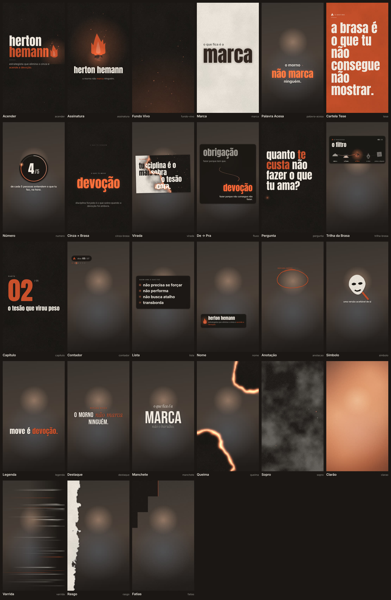

- **Ver tudo rodando, trocar texto e mexer nas curvas:** abre `gallery/index.html` no navegador.
- **Instalar no Premiere:** [docs/INSTALAR.md](docs/INSTALAR.md).
- **Qual animação usar em cada momento do vídeo:** [docs/GUIA.md](docs/GUIA.md).
- **Montar o plano de animações a partir da transcrição:** [docs/PLANO-DE-ANIMACAO.md](docs/PLANO-DE-ANIMACAO.md).
- **Referências, engenharia reversa e fontes:** [docs/REFERENCIAS.md](docs/REFERENCIAS.md).
- **Chama em stop motion com tuas imagens:** [docs/CHAMA-STOP-MOTION.md](docs/CHAMA-STOP-MOTION.md).

---

## As animações

Organizadas pelo que fazem com quem assiste.

### Acender — abrir, fechar e dar fundo

| | Animação | O que acontece |
|---|---|---|
| 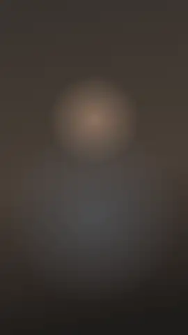 | **Acender** | O nome começa coberto de cinza. Um sopro leva a cinza embora, a brasa aparece por baixo, a chama acende e a frase entra. |
| 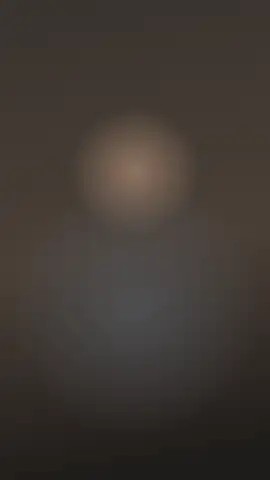 | **Assinatura** | A chama acende sobre uma brasa, o nome entra, e no fim a chama se consome sozinha. O que fica é a brasa respirando. Fecha sem pedir nada. |
| 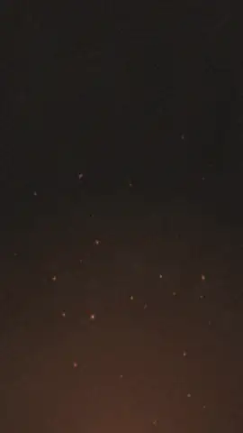 | **Fundo Vivo** | Papel ou tinta com cinza flutuando e brasa subindo de leve. Loop sem emenda pra cartela ou citação. |

### Marcar — o que tem que ficar no outro

| | Animação | O que acontece |
|---|---|---|
| 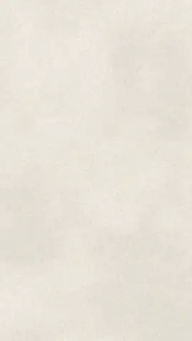 | **Marca** | A palavra desce quente como ferro em brasa, bate, chamusca o papel e esfria. Uma por vídeo. |
| 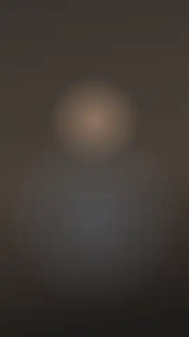 | **Palavra Acesa** | Duas linhas em minúsculas e a palavra-chave no meio: entra cinza, esquenta até virar brasa e fica respirando. |
| 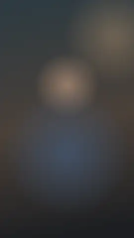 | **Cartela Tese** | A frase que o outro vai printar, em papel, tinta ou brasa. As linhas sobem como calor e entram em foco. |
|  | **Número** | Número contando dentro de um anel que esquenta do cinza à brasa. Com total, o anel mostra a proporção. |

### Virar — mudar a percepção

| | Animação | O que acontece |
|---|---|---|
| 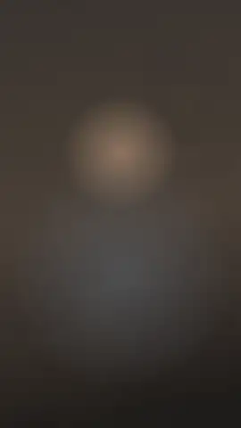 | **Cinza × Brasa** | A primeira palavra esfria, vira cinza e se desfaz. A segunda chega coberta de cinza, a cinza sobe e ela acende. |
| 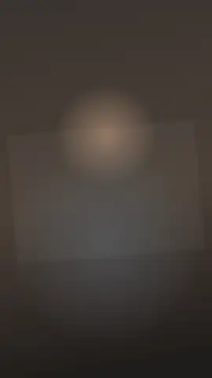 | **Virada** | Um cartão com o que te venderam pega fogo a partir de um canto. Por baixo aparece o que é. |
| 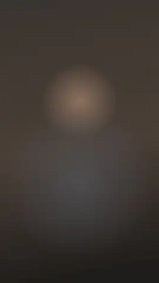 | **De → Pra** | Palavra fria de um lado, quente do outro. Uma fagulha percorre a curva e acende a segunda. |
|  | **Pergunta** | A pergunta entra palavra por palavra e uma brasa fica respirando embaixo: o tempo de responder por dentro. |

### Guiar — mostrar onde a pessoa está

| | Animação | O que acontece |
|---|---|---|
| 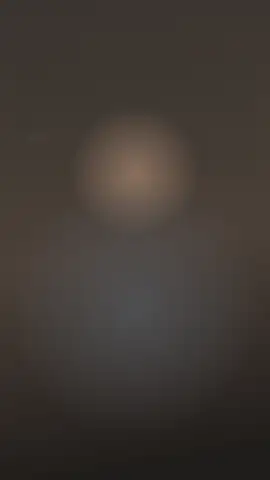 | **Trilha da Brasa** | As etapas do teu processo num caminho ondulado, cada uma com um ícone da cinza à brasa (cinza, sopro, brasa, chama, marca). A atual acende. |
|  | **Capítulo** | Cartela de parte com número rolando, entrando e saindo com borda acesa. |
|  | **Contador** | "dica 03 / 07" no canto, com uma fileira de brasas: as que já foram acesas, a atual respirando, as próximas frias. |
| 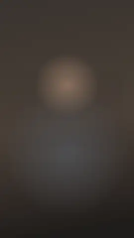 | **Lista** | Itens curtos entrando um a um, cada marcador é uma brasa que acende quando o item chega. |

### Apontar — quem fala, o que olhar

| | Animação | O que acontece |
|---|---|---|
| 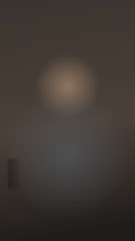 | **Nome** | A chama acende ao lado do nome e a frase de posicionamento entra embaixo, com o trecho que importa em brasa. |
| 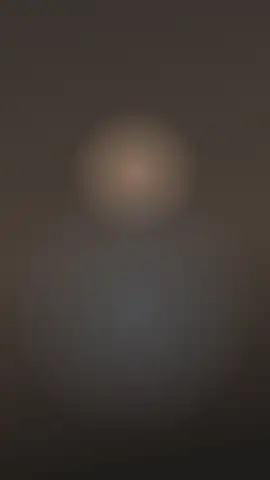 | **Anotação** | Traço de caneta em brasa feito à mão: círculo, sublinhado, seta, xis ou colchete. |
| 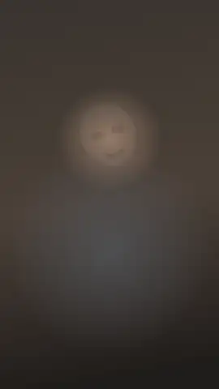 | **Símbolo** | Ícone de papel recortado que cai e assenta, em stop motion: máscara, espelho, ímã, etiqueta, digital, ampulheta, chave, lupa, balão, chama, brasa ou cinza. |

### Texto — legenda e destaque

Só tipografia, com uma fonte ou um par (principal + complemento) e seis efeitos de entrada. Dá pra **arrastar o texto na prévia** com o mouse (a roda muda o tamanho).

| | Animação | O que acontece |
|---|---|---|
|  | **Legenda** | Palavra por palavra no tempo da fala, em grupos de 1 a 8. A palavra importante fica em brasa e a atual dá um pop. Aceita o tempo de cada palavra (o plano preenche). |
| 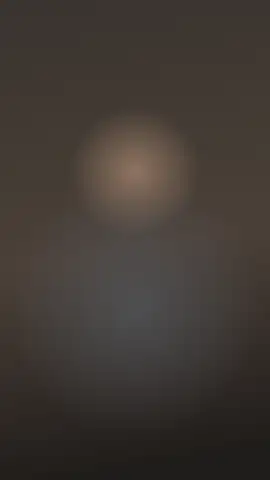 | **Destaque** | Uma frase entra linha por linha (foco, tracking, subida, obturador...) e o trecho que importa troca de cor e de fonte. Pra grifar algo interessante que alguém disse. |
|  | **Manchete** | Palavra grande no centro com linhas pequenas de complemento em cima e embaixo, cada camada no seu tempo. |

Efeitos: **pop**, **foco** (desfocado → nítido), **tracking**, **subida**, **obturador** (rastro) e **cinema**. Fontes: Anton, Bebas Neue, Instrument Serif, Inter, DM Serif e Caveat, em 9 combinações. A pesquisa por trás está em [docs/REFERENCIAS.md](docs/REFERENCIAS.md).

### Passagens — esconder o corte

| | Animação | O que acontece |
|---|---|---|
|  | **Queima** | A imagem pega fogo pelos cantos, vira carvão e o carvão se desfaz revelando o próximo clipe. |
| 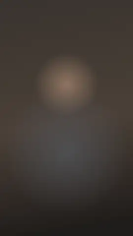 | **Sopro** | Uma rajada de fumaça e cinza atravessa a tela. Mais leve que a queima. |
|  | **Clarão** | Vazamento de luz quente que estoura no corte. De brasa a pêssego, sem amarelo. |
|  | **Varrida** | Cortina de tinta com linhas de velocidade atravessa a tela como um giro de câmera. |
|  | **Rasgo** | Folha de papel puxada pela tela com borda rasgada, fibras e sombra. |
| 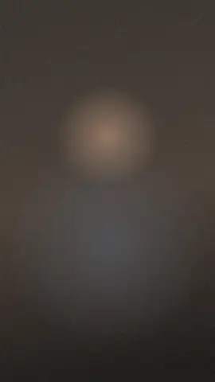 | **Fatias** | Faixas de tinta fecham a tela uma depois da outra e saem na mesma ordem. |

Todas funcionam em 9:16, 16:9, 1:1 e 4:5, em qualquer resolução e frame rate. As que vão por cima do vídeo saem com transparência.

---

## Curvas e câmera

**Curvas.** Cada animação tem duas curvas editáveis: a de **entrada** (como as coisas chegam) e a de **saída** (como vão embora). No painel e na galeria tem um editor igual ao gráfico do After Effects: duas alças pra arrastar e seis atalhos prontos.

| Atalho | Sensação |
|---|---|
| suave | chega rápido e assenta devagar (o padrão de entrada) |
| brasa | ainda mais macia no final, pra coisa que pousa |
| faísca | passa um pouco do ponto e volta, pra coisa pequena que salta |
| fôlego | começa e termina devagar, pra movimento grande |
| apagar | sai devagar e acelera no fim, como chama que se consome (o padrão de saída) |
| linear | velocidade constante |

**Câmera.** O render passa por um pós-processamento que dá jeito de filmado, e cada animação guarda o seu ajuste:

- **desfoque de movimento**: o que se mexe rápido borra como num obturador de 180°;
- **desfoque de borda**: as bordas saem de foco e o miolo fica nítido, como lente de cinema;
- **aberração cromática**: vermelho e azul se separam um pouco, mais forte nas bordas e só onde tem movimento;
- **lente**: distorção de barril bem sutil;
- **turbulência**: o quadro treme a 12 por segundo, como papel na brisa (o *turbulent displace* do After Effects);
- **ruído**: grão de filme que muda a cada quadro, só onde tem imagem.

Atalhos prontos: **padrão**, **cinema** (borda desfocada + grão), **tremido**, **sujo** e **limpo**. No painel fica em *Câmera*; no render em lote são as flags `--edge`, `--displace`, `--noise` ou `--fx-preset cinema`.

## Plano a partir da transcrição

Entrega a transcrição do vídeo (SRT, VTT ou texto com tempos) e recebe um plano: cada animação com o segundo em que entra, o texto que leva e o porquê, mais propostas de animações que o banco ainda não tem. O painel tem a aba **Plano** pra pôr marcadores na timeline ou inserir tudo nos tempos certos. Como funciona e como usar: [docs/PLANO-DE-ANIMACAO.md](docs/PLANO-DE-ANIMACAO.md).

---

## Como funciona

```
plugin/tamocriando-motion/      ← pasta que vai pro Premiere
  engine/core.js                ← motor: curvas, texto, chama, brasa, cinza, fagulha, papel, máscaras de queima
  engine/fx.js                  ← câmera: desfoque de movimento e de borda, aberração, lente, turbulência, ruído (WebGL)
  engine/sinais.json            ← pra cada animação: que sinais na fala pedem ela e quando evitar
  engine/flame-frames.js        ← quadros da chama em stop motion (vazio = poses geradas por código)
  engine/brands.js              ← marca (cores, fontes, assinatura)
  engine/templates/*.js         ← as 27 animações, um arquivo por grupo
  ui/curve-editor.js            ← editor de curvas (painel e galeria)
  ui/drag-stage.js              ← arrastar o texto na prévia
  index.html, panel.js/.css     ← painel
  host/premiere.jsx             ← ponte com o Premiere (importa e coloca no playhead)
  fonts/                        ← Anton, Inter, Bebas Neue, Instrument Serif, DM Serif Display, Caveat (OFL)
gallery/                        ← galeria pra navegador
tools/render.mjs                ← render em lote (MOV com alpha, prévias)
tools/plano.mjs                 ← transcrição → plano: ler, prompt, validar, storyboard
tools/importar-chama.mjs        ← importa quadros de chama (ChatGPT, desenho, vídeo)
tools/smoke-test.mjs            ← teste de tudo sem precisar do Premiere
install/                        ← instaladores Windows e Mac
docs/                           ← guia, instalação, catálogo
```

Cada animação é uma função que desenha um frame a partir do tempo `t` num `<canvas>`. Nada depende do frame anterior, então o mesmo código serve pra prévia no painel, pra galeria e pro render final, em qualquer tamanho. O painel desenha frame a frame (já com o pós-processamento), grava PNG com transparência na pasta do projeto e pede pro Premiere importar como sequência de imagens no frame rate da sequência.

## Gerar os vídeos fora do Premiere

Pra quem edita em outro programa (DaVinci, CapCut, After Effects) ou quer um pacote fixo:

```bash
npm install
npm run render                                    # tudo, 9:16 e 16:9, ProRes 4444 com alpha
node tools/render.mjs --only nome --formats 16:9 --params '{"nome":"ana souza","cargo":"fundadora da guapa"}'
node tools/render.mjs --codec png                 # QuickTime PNG: bem menor que ProRes, também com alpha
node tools/render.mjs --fps 25 --formats 1:1      # outro frame rate / formato
node tools/render.mjs --fx-preset cinema          # câmera com borda desfocada e grão (ou --edge 50 --noise 20)
node tools/render.mjs --aberration 20 --lens 0    # câmera mais discreta (--no-fx desliga tudo)
node tools/render.mjs --catalog                   # imagem com todas
```

Saída em `renders/` (fica fora do Git: o pacote completo em ProRes passa de 1 GB).

## Marca de cliente

A marca é um bloco em `plugin/tamocriando-motion/engine/brands.js`. Os templates nunca usam cor solta, usam papéis: `ember` (brasa), `paper` (papel), `ink` (tinta), `ash` (cinza), mais `glow`, `hot`, `crust` e `paperShade`, que são tons derivados pra fogo e textura. Pra um cliente:

1. Copia o bloco `herton`, dá um id novo (`'guapa'`).
2. Troca `colors` pelas cores dele e `sign` pelos textos (nome, cargo, trecho em destaque).
3. Fonte diferente: coloca o `.ttf` em `fonts/`, declara em `fonts.css` e aponta em `fonts`.

Com mais de uma marca, aparece um seletor no painel e na galeria.

## Criar uma animação nova

```js
TC.register({
  id: 'minha-animacao',
  name: 'Minha Animação',
  category: 'marcar',                // acender, marcar, virar, guiar, apontar, texto, passagem
  duration: 4,
  params: [{ key: 'texto', label: 'Texto', type: 'text', default: 'olá' }],
  description: 'O que ela faz.',
  uso: 'Quando usar.',
  draw: function (S, t) {
    var k = S.inK(0, 0.6);           // 0→1 entre 0s e 0,6s, com a curva de entrada editável
    var out = S.outK(S.dur - 0.5, S.dur); // 0→1 no fim, com a curva de saída
    S.font('display', 120 * S.u);    // S.u = 1px em 1080p, escala sozinho
    S.c.globalAlpha = k * (1 - out);
    S.text(S.p.texto, S.w / 2, S.h / 2 + (1 - k) * 80 * S.u, { align: 'center', color: S.col.paper });
  }
});
```

Coloca num arquivo de `engine/templates/`, adiciona em `engine/scripts.json`, no `index.html` do painel e em `gallery/galeria.html`, escreve a entrada dela em `engine/sinais.json` (o teste cobra) e roda `node tools/smoke-test.mjs`. Com `drag: { x: 'px', y: 'py' }` na definição, o texto passa a poder ser arrastado na prévia.

## Testes

```bash
node tools/smoke-test.mjs
```

Desenha todas as animações em todos os formatos (com e sem o pós-processamento, inclusive com campos vazios), abre o painel com o Premiere simulado, renderiza e confere a chamada de importação, e valida a sintaxe do script do Premiere.

O que **não** dá pra testar fora do Premiere: a importação real e a colocação na trilha (`host/premiere.jsx`). Esse arquivo usa só a API documentada do Premiere (`importFiles` como sequência de imagens, `setOverrideFrameRate`, `overwriteClip`), mas o primeiro uso de verdade é o teste final. Se algo falhar, o console em `http://localhost:8088` mostra o erro.
