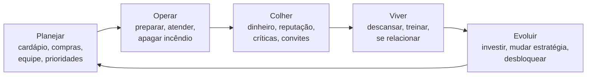
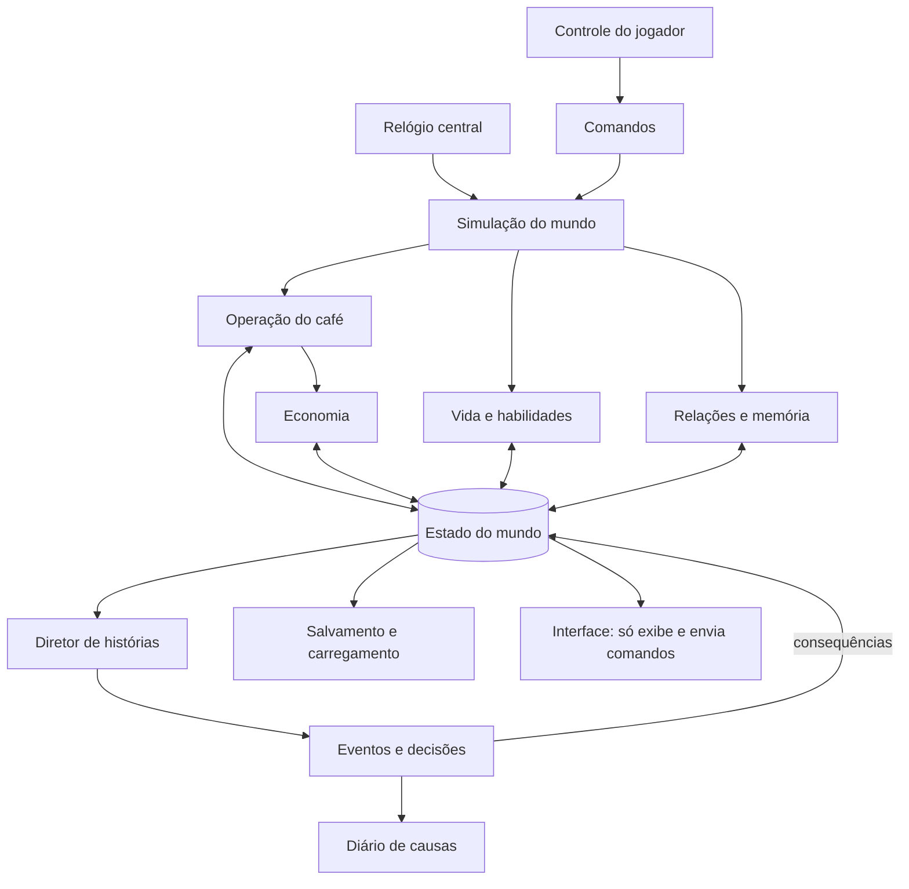

# Café (título provisório) — Documento de Conceito

> Versão 0.1 · solo, PC · escopo de protótipo
> Cooperativo está fora deste documento de propósito. Volta à mesa depois que a vertical slice provar o núcleo.

---

## 0. O jogo numa página

**Premissa.** Tu chega numa cidade com pouco dinheiro, um café minúsculo e equipamento usado. Precisa manter o negócio de pé enquanto constrói uma vida: amizades, rivalidades, habilidades, saúde, talvez um amor.

**Tese.** O jogador não está tentando construir o melhor café possível. Está tentando construir o café que acredita que deve existir, sem destruir a própria vida no processo.

**O que torna diferente.** Num simulador de gestão tradicional, tu melhora o restaurante e recebe recompensa. Aqui, melhorar o restaurante muda tua rotina, a rotina muda tuas relações, e as relações mudam as oportunidades que aparecem pro negócio. A história nasce desse efeito dominó.

| | |
|---|---|
| Gênero | Simulação de vida + gestão com operação em tempo real |
| Plataforma | PC (teclado/mouse, controle como bônus) |
| Modo | Um jogador |
| Câmera | Uma câmera, três níveis de zoom: personagem, gestão, decisão |
| Estrutura | Capítulos disparados por marcos, simulação persistente entre eles |
| Narrativa | Emergente, gerada por eventos sistêmicos com memória |

**Referências e o que pegar de cada uma**

| Referência | O que entra no jogo |
|---|---|
| Punch Club | Tempo como moeda: treinar uma coisa é deixar de treinar outra |
| The Sims | Necessidades, rotina, personalidade que muda |
| Overcooked | Expediente como operação física: layout, fluxo, imprevisto |
| Detroit: Become Human | Estrutura de decisão com custo, não a apresentação cinematográfica |
| Café Mania | Orgulho do espaço: decorar, expandir, deixar com a tua cara |
| **Stardew Valley** *(acréscimo)* | O vizinho comercial mais próximo. Prova que vida + negócio + relações funciona em escopo indie. É também com quem o jogo vai ser comparado |
| **RimWorld** *(acréscimo)* | O "diretor de histórias": um sistema que escolhe *quando* soltar um evento pra criar ritmo, em vez de sortear à toa |

> **Por que acrescentar as duas.** Stardew é o benchmark que o público vai usar, então o posicionamento precisa ser claro: Stardew é sobre fugir da pressão; este jogo é sobre *conviver* com ela e escolher o que sacrificar. RimWorld resolve o problema mais difícil do teu desenho, que é fazer histórias emergentes parecerem escritas.

---

## 1. Pilares de design

1. **Construir algo próprio.** Cardápio, espaço, equipamento, identidade comercial.
2. **Viver sob restrição.** Tempo, energia, dinheiro e atenção são finitos e competem entre si.
3. **Relações que mudam coisas.** Pessoas têm interesses e memória. Abrem e fecham portas.
4. **Consequência real.** Escolhas alteram regras e oportunidades futuras, não só uma barra.

**Regra de corte.** Se um sistema não altera pelo menos um outro sistema, ele não entra. Uma amizade que não muda nada no negócio ou na vida é decoração, e decoração não precisa de simulação.

**Regra de identidade.** Ninguém é obrigado a virar magnata. Um café pequeno, saudável e amado pelo bairro é uma forma legítima de vencer.

---

## 2. Câmera e controle

A decisão aqui é **uma única câmera com zoom**, não três modos separados. É como um mapa no celular: tu aproxima pra ver a rua, afasta pra ver o bairro, mas é o mesmo mapa.

| Nível | O que o jogador faz | Tempo |
|---|---|---|
| **Personagem** (perto, 3/4 de cima) | Anda, pega, prepara, entrega, conversa | Normal |
| **Gestão** (afastado, planta do café) | Move móveis, define cardápio, escala da equipe, lê relatórios | Desacelera a 25% durante o expediente; pausa fora dele |
| **Decisão** (enquadra os envolvidos) | Escolhe num evento | Pausa, com exceção de eventos marcados como urgentes |

Por que isso importa: com câmera única, um protótipo com vista 3/4 de cima resolve os três níveis só mudando altura e ângulo. Evita fazer duas UIs, dois sistemas de input e duas direções de arte.

**Trava anti-abuso.** Durante o expediente, o modo gestão tem um custo: o personagem fica parado enquanto tu planeja. Desacelerar não é congelar, então reorganizar a cozinha no meio do caos é uma escolha, não um cheat.

---

## 3. Estrutura do tempo

Três escalas, cada uma com uma função:

| Escala | Função | Pergunta que o jogador responde |
|---|---|---|
| **Minuto** | Execução | "Consigo dar conta disso agora?" |
| **Dia** | Gestão | "No que eu gasto o dia de hoje?" |
| **Capítulo** | Estratégia | "Que tipo de negócio e de pessoa eu estou virando?" |

### O dia (alvo: 12 a 18 minutos reais)

| Fase | Duração real | Pressão | O que acontece |
|---|---|---|---|
| Manhã | ~3 min | Baixa, tempo corre por ação | Compras, preparo antecipado, cardápio, treino, uma conversa |
| Expediente | ~6–8 min | Alta, tempo real | Clientes, pedidos, imprevistos |
| Noite | ~3 min | Média, tempo corre por ação | Contas, descanso, sair com alguém, visitar a cidade |
| Fechamento | ~1 min | Nenhuma | Resumo: dinheiro, relações, o que mudou, o que vem aí |

Na manhã e na noite, o relógio avança **por ação**, não em tempo real: comprar ingredientes custa 1 hora, conversar com alguém custa 2. Assim o jogador pensa sem ser apressado, mas toda escolha tem preço.

> **Contraste é o tempero.** Se tudo é urgente, nada é. O expediente só é tenso porque o resto do dia respira.

### Simulação em camadas (o truque técnico)

Nem tudo é simulado com a mesma resolução, igual a um palco de teatro: quem está sob o holofote atua por inteiro, quem está na coxia só existe no roteiro.

- **Alta resolução:** o café durante o expediente (clientes e funcionários com comportamento completo).
- **Média:** o local onde o jogador está fora do expediente.
- **Baixa:** o resto da cidade, que só atualiza agendas e estados no fechamento do dia.

---

## 4. Loop principal



O dia seguinte nunca começa igual, porque o mundo e o personagem já mudaram.

O loop precisa pagar três recompensas ao mesmo tempo:

| Prazo | Exemplo | Sem ela… |
|---|---|---|
| Imediata | Fechar um expediente difícil sem perder cliente | o jogo vira planilha |
| Média | Comprar a máquina de espresso nova, ganhar a confiança de alguém | não há sensação de progresso |
| Longa | Abrir segunda unidade, virar chef reconhecido, virar o coração do bairro | vira lista de tarefas sem propósito |

---

## 5. Sistemas integrados

Cada sistema abaixo traz: o que faz, as variáveis mínimas pro protótipo e com quem conversa. As conexões são o que importa.

### A. Operação do café
O expediente. Pedidos chegam, o jogador monta a receita passando por estações (moedor → máquina → balcão), entrega e recebe.
- **Variáveis:** fila, paciência do cliente, tempo de preparo, qualidade, custo por item.
- **Lê de:** habilidades (velocidade, qualidade), equipamentos (fluxo), reputação (quantos e quais clientes vêm), estresse (erros).
- **Escreve em:** economia (receita), relações (cliente bem ou mal atendido), vida (energia gasta).

### B. Economia
Transforma trabalho em crescimento e crescimento em novos custos.
- **Variáveis:** caixa, lucro do dia, custos fixos (aluguel, salários), estoque, reputação.
- **Lê de:** operação (vendas), decisões (investimentos, preços).
- **Escreve em:** operação (o que dá pra comprar), eventos (caixa baixo dispara problemas; caixa alto atrai propostas).

### C. Vida e habilidades
O personagem também é simulado.
- **Variáveis:** energia, saúde, estresse, tempo livre. Habilidades: **cozinha, atendimento, gestão**.
- **Lê de:** operação (cansaço do expediente), relações (apoio social reduz estresse).
- **Escreve em:** operação (desempenho), eventos (estresse alto libera eventos de crise).

> **Insight: o estresse é a ponte.** Ele é a única variável que todo sistema mexe e que todo sistema sente. Trabalhar demais sobe, amizade baixa, dinheiro curto sobe, café cheio sobe. Se o protótipo tiver só uma variável de vida bem feita, que seja essa. Energia e saúde podem esperar.

### D. Relações e memória
A fonte das histórias.
- **Variáveis por personagem:** afinidade (−100 a 100), confiança (separada de afinidade), objetivo atual, **memória curta** (os 5 a 8 fatos mais marcantes envolvendo o jogador).
- **Lê de:** operação, decisões, presença (tu apareceu ou sumiu?).
- **Escreve em:** eventos (quem oferece o quê), economia (indicações, descontos de fornecedor), operação (funcionário motivado ou não).

Afinidade e confiança separadas fazem diferença: alguém pode gostar de ti e mesmo assim não te emprestar dinheiro.

### E. Eventos e decisões
A camada que transforma números em narrativa. Detalhada na seção 7.

### Matriz de conexões (protótipo)

| De ↓ / Para → | Operação | Economia | Vida | Relações | Eventos |
|---|---|---|---|---|---|
| **Operação** | — | receita | energia, estresse | satisfação de clientes | fila alta por dias |
| **Economia** | o que comprar | — | estresse por dívida | — | caixa baixo/alto |
| **Vida** | velocidade, erros | — | — | presença social | crise pessoal |
| **Relações** | moral da equipe | indicações | apoio (−estresse) | — | quem aparece, o que oferece |
| **Eventos** | muda regras | aplica custo | aplica efeito | grava memória | encadeia |

Se uma célula estiver vazia num teste e o jogo parecer raso naquele ponto, é ali que falta conexão.

---

## 6. Arquitetura lógica

Teu diagrama já tem a espinha certa. Proponho três ajustes:

1. **Explicitar o Relógio central.** Hoje ele está implícito dentro de "Simulação do mundo". Ele merece caixa própria, porque é quem decide quando cada sistema roda e em que resolução.
2. **Estado do mundo no centro, não no fim.** Os sistemas não falam entre si direto. Todos leem e escrevem no estado, como sócios que só conversam por uma planilha compartilhada. Ninguém precisa saber como o outro trabalha por dentro.
3. **Eventos como único "escritor cruzado".** Operação, Vida e Relações escrevem cada um na sua parte do estado. Quando algo precisa atravessar sistemas (o investidor que mexe em dinheiro, cardápio e relação de uma vez), passa pelo sistema de eventos, que aplica consequências registradas. Isso deixa toda consequência rastreável, o que é ouro pra balancear e depurar.



Regras que valem desde o primeiro commit:
- Um relógio só controla o tempo.
- Ação do jogador vira **comando**; o sistema dono decide o que acontece. A UI nunca altera estado direto.
- Eventos, receitas, personagens e itens são **dados** (arquivos), não código. Quem escreve evento novo não precisa programar.
- Salvar = serializar o estado do mundo. Se algo não está no estado, não existe depois de carregar.

---

## 7. Narrativa emergente

### Anatomia de um evento

| Parte | Função |
|---|---|
| **Gatilho** | Condição que torna o evento possível |
| **Contexto** | Variáveis que moldam a versão concreta da cena |
| **Escolhas** | O que o jogador pode fazer (algumas aparecem só se condições forem atendidas) |
| **Consequências** | Efeitos imediatos + efeitos agendados + memórias gravadas |

Exemplo em formato de dado (é assim que ele viveria no projeto):

```yaml
id: funcionario_sobrecarregado
gatilho:
  - funcionario.estresse > 70
  - operacao.fila_media_3dias > 6
intervalo_minimo_dias: 10
contexto:
  caixa: economia.caixa
  reputacao: economia.reputacao
escolhas:
  - texto: "Enxugar o cardápio"
    efeitos: { operacao.complexidade: -1, economia.demanda: -10% }
  - texto: "Contratar ajuda"
    requer: economia.caixa >= 400
    efeitos: { economia.custo_fixo: +80/semana, funcionario.estresse: -30 }
  - texto: "Subir os preços"
    efeitos: { economia.margem: +15%, economia.demanda: -20% }
    memoria: { clientes_fieis: "subiu os preços quando o café lotou" }
  - texto: "Eu mesmo cubro as horas"
    efeitos: { vida.tempo_livre: -2h/dia, funcionario.afinidade: +15 }
    agenda: { em_dias: 7, evento: protagonista_esgotado, se: vida.estresse > 60 }
```

Nenhuma opção é a certa. Cada uma é uma estratégia.

### Diretor de histórias (acréscimo)

Sem um diretor, eventos sistêmicos viram roleta: três crises no mesmo dia, depois uma semana de nada. O diretor é um sistema simples que olha a **tensão recente** e decide se é hora de apertar ou de dar respiro.

- Mantém uma medida de tensão (dias seguidos de crise, caixa, estresse).
- Depois de um pico, prefere eventos leves ou positivos.
- Depois de calmaria longa, libera eventos de pressão ou oportunidade.
- Respeita intervalos mínimos e bloqueia contradições (o fornecedor que faliu não volta oferecendo desconto).

É o editor de uma série: os acontecimentos já existem, ele decide a ordem e o ritmo.

### O problema que ninguém resolve de cara: legibilidade (acréscimo)

Consequência atrasada tem um risco escondido. Se o jogador recusou ajudar a dona Lúcia no dia 3 e ela fecha uma porta no dia 20, **ele não vai ligar uma coisa à outra**. Pra ele, vai parecer azar. E consequência que parece azar é pior do que nenhuma consequência.

Duas soluções baratas:
1. **Callback na cena.** Quando uma memória gravada pesa numa decisão, o personagem fala dela. "Tu não apareceu quando eu precisei. Agora não dá."
2. **Diário de causas.** Um caderno do personagem, acessível no fechamento do dia, que registra decisões marcantes e, depois, liga a consequência à causa. Funciona também como resumo pra quem volta ao jogo depois de dias.

É isso que transforma "aconteceu uma coisa" em "aconteceu por causa do que eu fiz", que é exatamente a história que o jogador conta pro amigo.

---

## 8. Capítulos

Capítulo define **o problema da fase**. A simulação define **como** o jogador enfrenta. Cada capítulo começa quando condições são atingidas, não numa data fixa.

| # | Nome | Problema central | Entra quando… |
|---|---|---|---|
| 1 | As portas estão abertas | Sobreviver e aprender | Início |
| 2 | O bairro começa a te conhecer | Reputação, primeiros vínculos, primeiro concorrente | Sobreviveu ao 1º mês com caixa positivo |
| 3 | Crescer tem um preço | Delegar, equipe, vida pessoal espremida | Reputação ≥ X **ou** proposta de expansão aceita |
| 4 | O que tu está construindo? | Grande decisão de identidade | Acumulado de escolhas do capítulo 3 |

### O que falta no desenho original: como se perde e como termina (acréscimo)

**Derrota.** Precisa existir, senão as escolhas não pesam. Mas game over seco num jogo de 30 horas é cruel. Proposta: **falência não encerra, transforma.** O café fecha, tu perde parte do progresso, e abre um capítulo alternativo ("Recomeçar"), trabalhando pra outra pessoa, possivelmente pro rival. Vira história, não punição.

**Esgotamento.** Estresse no máximo por vários dias força um evento de colapso: dias perdidos, relações abaladas. É o jeito do jogo dizer "tu exagerou" sem tirar o controle de vez.

**Final.** O capítulo 4 termina com um **epílogo montado a partir do estado**: o tamanho do negócio, quem ficou do teu lado, quem virou rival, que tipo de pessoa tu virou (pelos padrões de comportamento). Depois do epílogo, modo livre opcional.

### Identidade emergente

Não há classe. O jogo observa padrões (onde tu gasta o tempo, como trata equipe, se prioriza lucro ou gente) e, ao cruzar limiares, abre oportunidades coerentes: o chef recebe convite de crítico gastronômico; o negociador, proposta de fornecedor exclusivo; quem cuida da equipe, uma funcionária que vira gerente e permite a segunda unidade.

---

## 9. Escopo inicial

Aqui é onde projeto indie bom costuma morrer: construir a visão final antes de provar que o núcleo diverte. Por isso o escopo é propositalmente apertado.

### O protótipo-alvo: **5 dias num café**

> Um café · três receitas · um funcionário · três personagens sociais · cinco dias.

Nesse espaço, uma partida tem que mostrar o ciclo completo: preparar, atender, enfrentar uma decisão difícil, viver a consequência e começar o dia seguinte diferente.

**Entra**
- Personagem controlável, câmera com dois níveis (personagem e gestão).
- 3 estações (moedor, máquina, balcão), 3 receitas (espresso, cappuccino, pão de queijo).
- Clientes com fila, paciência e satisfação.
- Caixa, custo de ingrediente, aluguel, fechamento do dia.
- Estresse + 1 habilidade (cozinha) que sobe com uso.
- 1 funcionário que pode ser escalado numa estação.
- 3 personagens: **cliente fiel**, **comerciante rival**, **um amigo na cidade**. Cada um com afinidade, confiança e memória curta.
- 6 a 10 eventos em dados, um diretor simples, diário de causas básico.
- Salvar e carregar.
- Arte: blocos cinza. Nenhum asset final.

**Não entra (ainda)**
Cidade navegável, romance, árvore de habilidades, decoração, capítulos 2–4, segunda unidade, investidor, áudio final, cooperativo.

### Etapas

| Etapa | Estimativa (1 pessoa experiente) | Critério pra avançar |
|---|---|---|
| **1. Protótipo do expediente** | 4–8 semanas | Um dia de operação é divertido a ponto de querer abrir de novo |
| **2. Protótipo sistêmico** (os 5 dias acima) | +6–10 semanas | Decisões fora da cozinha mudam o expediente, e vice-versa |
| **3. Vertical slice** | +8–12 semanas | Capítulo 1 completo, bairro pequeno, 5–8 personagens, arte e áudio próximos do final. Alguém de fora joga, entende e quer continuar |
| **4. Produção** | Definido depois da etapa 3 | — |

Os prazos são de planejamento, não promessa. Dependem da engine, da experiência e principalmente da arte.

### Recomendação de engine

**Godot 4**, salvo se tu já domina Unity. Motivos: gratuita e sem royalties, leve, boa pra 2D e 3D estilizado, e o sistema de *Resources* casa bem com eventos e personagens como dados. Se tu vier de Unity, fica nela: trocar de ferramenta no meio do aprendizado custa mais do que qualquer vantagem técnica.

### Recomendação de arte

A conta que mais pesa num jogo desses não é código, é **animação de personagem**. Cada ação nova (limpar, carregar bandeja, sentar, conversar) multiplica por cada personagem. Opções, da mais barata pra mais cara:
1. 3D low-poly com animações de biblioteca (Mixamo, por exemplo) e câmera 3/4 fixa.
2. 2D com personagens em poucos frames e muita expressão por ícone e balão.
3. Pixel art no estilo Stardew. Bonito, mas caro em frames e convida a comparação direta.

Pra quem trabalha sozinho, a opção 1 costuma ser a mais segura.

---

## 10. Riscos de design

| Risco | Sintoma no teste | Antídoto |
|---|---|---|
| Vida vira lista de obrigações | Jogador cumpre necessidades por obrigação, sem escolher | Necessidades geram escolhas, não punição contínua. Menos barras, mais trocas |
| Caos depende de reflexo | Quem corre mais ganha, quem planeja não | Layout e preparo antecipado precisam reduzir o caos de forma visível |
| Relação vira barra de afinidade | Jogador não lembra o nome de ninguém | Relação muda o que a pessoa faz, sabe ou oferece. Memória e callbacks |
| Escolha que não muda nada | "Tanto faz o que eu escolhi" | Toda escolha altera estado, abre ou fecha algo, e isso aparece no diário |
| Crescimento apaga o jogo | Depois de contratar, jogador só assiste | Delegar troca o tipo de problema (pessoas, processos), não elimina o jogador |
| Consequência parece azar *(acréscimo)* | Jogador culpa o RNG | Callback na cena + diário de causas |
| Escopo cresce antes de provar *(acréscimo)* | Fazendo cidade antes do expediente divertir | Nada da lista "não entra" é tocado antes do critério da etapa 2 |

---

## 11. Como saber se está funcionando

| Hipótese | O que observar | Como medir no protótipo |
|---|---|---|
| Operar é divertido | Joga o expediente mesmo sem recompensa nova | Quer jogar o dia 2 sem ser pedido |
| Gestão importa | Preparo e layout melhoram o resultado | Comparar fila média de quem reorganiza vs. quem não |
| Vida importa | Abre mão de dinheiro pra cuidar de si ou de alguém | Contar escolhas que trocam caixa por tempo/relação |
| Relações importam | Reconhece que uma relação mudou algo | Pergunta pós-teste: "alguém te ajudou ou te atrapalhou?" |
| Escolhas viram histórias | Conta espontaneamente algo inesperado | Pedir "me conta tua partida". Duas pessoas, duas histórias diferentes = sinal verde |

A última é o termômetro mais honesto do projeto inteiro.

---

## 12. Decisões em aberto

Coisas que precisam de resposta tua antes da etapa 1 terminar:

1. **Engine:** Godot ou outra que tu já conheça?
2. **Direção de arte:** 3D low-poly, 2D ou pixel art?
3. **Protagonista:** fixo (com história própria) ou criado pelo jogador? Fixo facilita escrever callbacks; criado aumenta identificação.
4. **Por que o personagem chegou à cidade?** Uma ambição inicial escolhida no começo (fugir de algo, provar algo, herdar o café) dá direção ao capítulo 1 e um fio pro epílogo.
5. **Ambientação:** cidade brasileira genérica, específica ou fictícia? Um bairro com cara de Brasil (pão de queijo no cardápio, fiado, vizinho que comenta tudo) é um diferencial raro nesse gênero.
6. **Título.**
